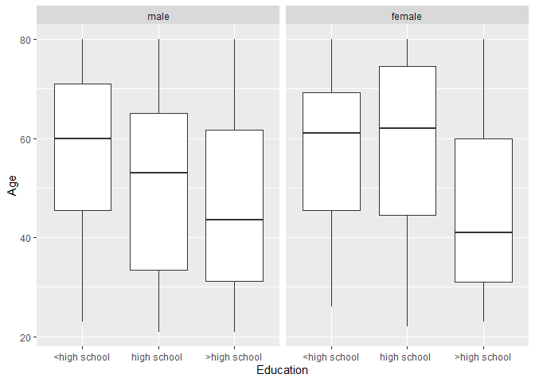
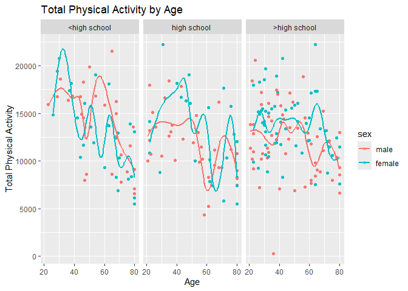
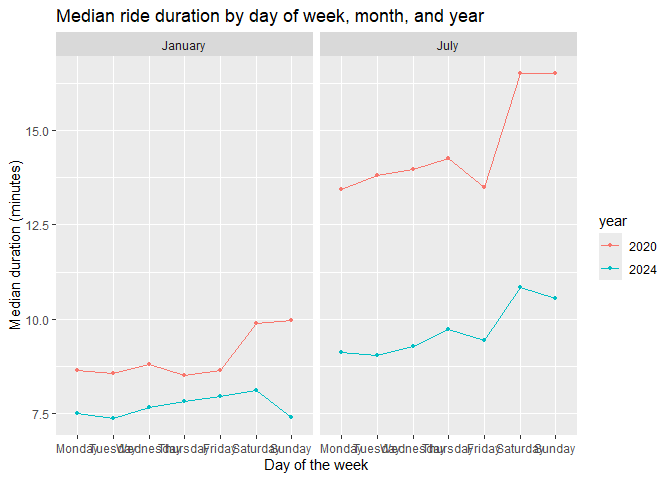
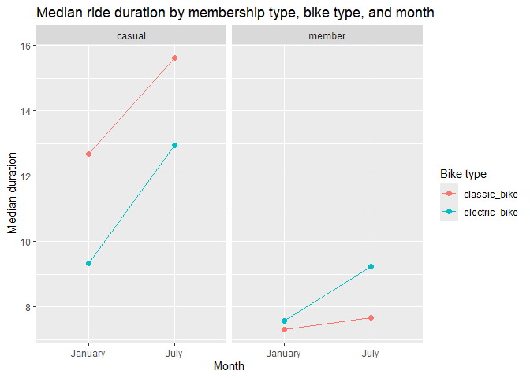

P8105 Homework 3 kad2243
================
Katherine Dunn

Load required libraries

``` r
library(tidyverse)
library(dplyr)
library(measurements)
```

# Problem 1

Importing the NY NOAA data set from the p8105 library.

``` r
library(p8105.datasets)
data("ny_noaa")
```

The National Oceanic and Atmospheric Association data set contains
weather data that are available from weather stations globally. The NY
NOAA data set contains **2595176** observations and **7** variables.
Variables include **id, date, prcp, snow, snwd, tmax, tmin**. The data
are collected from **1981-01-01** to **2010-12-31**. ID refers to the
weather station ID from which data are collected. The range of values of
precipitation is **0, 22860** (tenths of mm). The range of values of
snowfall is **-13, 10160** (mm). The range of values of snowdepth is
**0, 9195** (mm). The average maximum temperature is **139.8** (tenths
of degrees C). The average minimum temperature is **30.3** (tenths of
degrees C).

## Further data cleaning, description and plotting

- Creating separate variables for year, month, and day.

``` r
ny_noaa = ny_noaa %>%
  mutate(
  year = year(date),
  month = month(date),
  day = day(date)
)
```

- Giving observations for temperature, precipitation, and snowfall
  reasonable units.

  Changing temperature variables to Fahrenheit, prcipitation and
  snowfall to inches.

``` r
ny_noaa = ny_noaa %>%
  mutate(
    tmax = as.numeric(tmax),
    tmin = as.numeric(tmin),
    prcp = prcp / 254,
    snow = snow / 25.4,
    snwd = snwd / 25.4,
    tmax = conv_unit(tmax / 10, "C", "F"),
    tmin = conv_unit(tmin / 10, "C", "F")
  )
```

- For snowfall, what are the most commonly observed values? Why?

  The most commonly observed snowfall value is **0** inches. Snowfall is
  seasonal in New York, thus commonly there is no snow.

- Two-panel plot showing the average max temperature in January and in
  July in each station across years.

``` r
ny_noaa %>%
  filter(month %in% c(1, 7)) %>%
  group_by(id, year, month) %>%
  summarize(mean_tmax = mean(tmax, na.rm = TRUE)) %>%
  ggplot(aes(x = year, y = mean_tmax, group = id)) +
  geom_point(alpha = 0.3) +
  facet_grid(. ~ month) +
  labs(
    title = "Average maximum temperature by station, January and July",
    x = "Year",
    y = "Mean max temperature (F)"
  )
```

<!-- -->

- Is there any observable / interpretable structure? Any outliers?

  Average temperature appears to be increasing slightly in January
  since 1980. There is yearly fluctuation in average temperature. There
  appears to be one major outlier in 1988 for average temp in July at
  one station.

- Two-panel plot showing tmax vs tmin for the full dataset (note that a
  scatterplot may not be the best option)

``` r
ny_noaa %>%
  pivot_longer(
    cols = c(tmax, tmin),
    names_to = "min_max",
    values_to = "temp"
  ) %>%
  ggplot(aes(x = temp)) +
  geom_histogram(bins = 50) +
  facet_grid(. ~ min_max) +
  labs(
    title = "Maximum and minimum temperature",
    x = "Temperature (F)",
    y = "Count"
  )
```

<!-- -->

- Plot showing the distribution of snowfall values greater than 0 and
  less than 100 separately by year.

``` r
ny_noaa %>%
  filter(snow > 0, snow < 100) %>%
  ggplot(aes(x = year, y = snow, group = year)) +
  geom_boxplot() +
  labs(x = "Year", y = "Snowfall (mm)")
```

<!-- -->

# Problem 2

Loading NHANES data - accelerometer and demographic data

``` r
nhanes_accel <- read_csv("data/nhanes_accel.csv")

nhanes_covar <- read_csv("data/nhanes_covar.csv", skip = 4)
```

Tidy Accelerometer data

``` r
nhanes_accel_long =
  nhanes_accel %>%
  pivot_longer(
    cols = starts_with("min"),
    names_to = "min",
    names_prefix = "min",
    values_to = "accel") %>%
         mutate(min = as.integer(min))
```

Merge and filter data sets:

- Exclude participants less than 21 years of age, and those with missing
  demographic data; and encode data with reasonable variable classes

``` r
nhanes <- nhanes_covar %>%
  filter(age >= 21, complete.cases(sex, age, BMI, education)) %>%
  left_join(nhanes_accel_long, by = "SEQN") %>%
  mutate(sex = factor(sex, labels = c("male", "female")),
        education = factor(education, labels = c("<high school", "high school ", ">high school")))
```

- Number of men and women in each education category

``` r
nhanes %>%
  distinct(SEQN, sex, education) %>%
  count(sex, education) %>%
  pivot_wider(names_from = education, values_from = n) %>%
  knitr::kable(caption = "Number of men and women by education category")
```

| sex    | \<high school | high school | \>high school |
|:-------|--------------:|------------:|--------------:|
| male   |            27 |          35 |            56 |
| female |            28 |          23 |            59 |

Number of men and women by education category

- Visualization of the age distributions for men and women in each
  education category.

``` r
nhanes %>%
  distinct(SEQN, sex, education, age) %>%
  ggplot(aes(x = education, y = age)) +
  geom_boxplot() +
  facet_grid(~ sex) +
  labs(x = "Education", y = "Age")
```

<!-- -->

- Those with more than a high school education are the most numerous in
  the sample. Educational categories are fairly evently distributed by
  sex. Those with more than a high school education tend to be younger
  in age in the sample data.

Plotting total activity by age - including sex and education

``` r
#Creating variable for total activity for unique SEQN
nhanes %>%
  mutate(total_act = sum(accel, na.rm = TRUE), .by = SEQN)%>%
  group_by(sex, education) %>%
  ggplot(aes(x = age, y = total_act, color = sex)) +
  geom_point(alpha = 0.3) +
  geom_smooth(se = FALSE) +
  facet_grid(. ~ education) +
  labs(
    title = "Total Physical Activity by Age",
    x = "Age",
    y = "Total Physical Activity"
  )
```

<!-- -->

- The total activity of participants generally decreases with age.
  Younger individuals with less than a high school education appear to
  be more physically active than other groups. Women appear, on average,
  to be more physically active than men.

Plotting activity throughout the day:

``` r
nhanes %>%
    ggplot(aes(x = min, y = accel, color = sex)) +
  geom_line(aes(group = SEQN), alpha = 0.1) +
  geom_smooth(se = FALSE) +
  facet_grid(. ~ education) +
  labs(
    title = "Physical Activity throughout the day",
    x = "time",
    y = "Physical Activity"
  )
```

<!-- -->

- There appears to be more variation in physical activity throughout the
  day in men and women with greater than a high school education.
  Activity generally peaks for all groups mid morning, and remains level
  through the evening. Women in the sample appear slightly more
  physically active than the men.

# Problem 3

Importing Citi bike Data & Merging. Creating variable for month and year

``` r
citi_jan20 <- read_csv("data/citi/Jan 2020 Citi.csv") %>%
  mutate(month = "January", year = 2020)

citi_jan24 <- read_csv("data/citi/Jan 2024 Citi.csv") %>%
  mutate(month = "January", year = 2024)

citi_jul20 <- read_csv("data/citi/July 2020 Citi.csv") %>%
  mutate(month = "July", year = 2020)

citi_jul24 <- read_csv("data/citi/July 2024 Citi.csv") %>%
  mutate(month = "July", year = 2024)

citi_all <- bind_rows(citi_jan20, citi_jan24, citi_jul20, citi_jul24)
```

The Citi Bike combined data contains **99485** rides and **9**
variables. Variables included are the ride ID, the type of ride: Classic
or Ebike, day of the week, duration of the ride, the station the ride
started in, the station the ride ended in, the membership type, month,
and year. The average duration of the rides included in the data set is
**13.9301375** minutes. There were **79862** member rides and **19623**
casual rides. There were **55536** classic rides and **43949** electric
rides.

Total number of rides in each combination of year and month separating
casual riders and Citi Bike members.

``` r
citi_all %>%
  group_by(member_casual)%>%
  count(year, month) %>%
  pivot_wider(names_from = member_casual, values_from = n) %>%
  knitr::kable(caption = "Rides by Membership Type")
```

| year | month   | casual | member |
|-----:|:--------|-------:|-------:|
| 2020 | January |    984 |  11436 |
| 2020 | July    |   5637 |  15411 |
| 2024 | January |   2108 |  16753 |
| 2024 | July    |  10894 |  36262 |

Rides by Membership Type

- Overall casual rides have increased dramatically between 2020
  and 2024. Ride usage increased in both years from january to july,
  likely due to weather. Casual rides increased more seasonally than did
  the membership rides.

Table showing the 5 most popular starting stations for July 2024;
include the number of rides originating from these stations.

``` r
citi_all %>%
  filter(year == 2024, month == "July") %>%
  count(start_station_name, sort = TRUE) %>%
  head(5) %>%
  knitr::kable(caption = "Top 5 starting stations, July 2024")
```

| start_station_name       |   n |
|:-------------------------|----:|
| Pier 61 at Chelsea Piers | 163 |
| University Pl & E 14 St  | 155 |
| W 21 St & 6 Ave          | 152 |
| West St & Chambers St    | 150 |
| W 31 St & 7 Ave          | 146 |

Top 5 starting stations, July 2024

Effects of day of the week, month, and year on median ride duration.

``` r
#Creating factors for day, month, year to group by
citi_all %>%
  mutate(
    weekdays = factor(weekdays,
                      levels = c("Monday", "Tuesday", "Wednesday", "Thursday","Friday", "Saturday", "Sunday")),
    month = factor(month),
    year = factor(year)) %>%
  group_by(weekdays, month, year) %>%
  summarize(median_duration = median(duration, na.rm = TRUE)) %>%
  ggplot(aes(x = weekdays, y = median_duration, color = year, group = year)) +
  geom_point(size = 1) +
  geom_line() +
  facet_grid(. ~ month) +
  labs(
    title = "Median ride duration by day of week, month, and year",
    x = "Day of the week",
    y = "Median duration (minutes)"
  ) 
```

<!-- --> -
Ride duration peaks on Saturdays, and is consistently higher in July
than January. Ride duration was actually shorter in 2024 than in 2020,
potentially pointing to more frequent but shorter rides.

There were relatively few electric Citi Bikes in 2020, but many more are
available now. For data in 2024, make a figure that shows the impact of
month, membership status, and bike type on the distribution of ride
duration. Comment on your results.

``` r
citi_all %>%
  filter(year == 2024) %>%
  mutate(month = factor(month)) %>%
  group_by(month, member_casual, rideable_type) %>%
  summarize(median_duration = median(duration, na.rm = TRUE)) %>%
  ggplot(aes(x = month, y = median_duration, color = rideable_type, group = rideable_type)) +
  geom_point(size = 2) +
  geom_line() +
  facet_grid(. ~ member_casual) +
  labs(
    title = "Median ride duration by membership type, bike type, and month",
    x = "Month",
    y = "Median duration",
    color = "Bike type")
```

<!-- -->

- Bike duration increased between January and July for both casual and
  member rides. Member usage of Ebikes and classic bikes was almost
  identical in January 2024. Ebike duration is longer among members, and
  classic bike duration is higher for casual riders. Casual riders had
  higher duration for all bike types during the same month.
