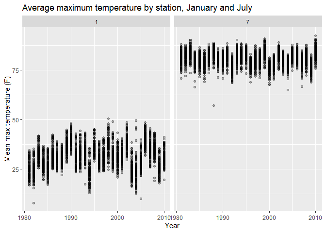
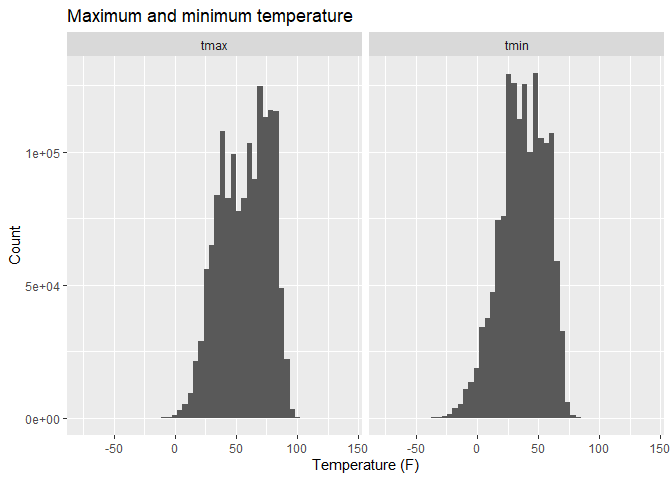
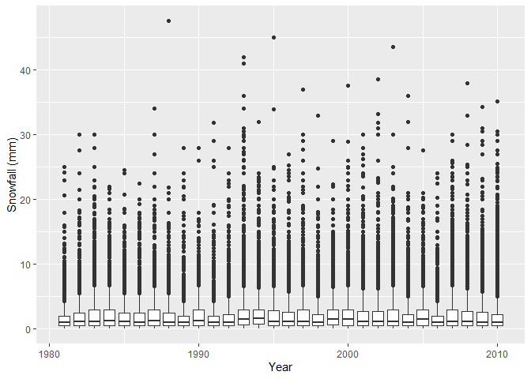

P8105 Homework 3 kad2243
================
Katherine Dunn

Load required libraries

``` r
library(tidyverse)
library(dplyr)
library(measurements)
```

# Problem 1

Importing the NY NOAA data set from the p8105 library.

``` r
library(p8105.datasets)
data("ny_noaa")
```

The National Oceanic and Atmospheric Association data set contains
weather data that are available from weather stations globally. The NY
NOAA data set contains **2595176** observations and **7** variables.
Variables include **id, date, prcp, snow, snwd, tmax, tmin**. The data
are collected from **1981-01-01** to **2010-12-31**. ID refers to the
weather station ID from which data are collected. The range of values of
precipitation is **0, 22860** (tenths of mm). The range of values of
snowfall is **-13, 10160** (mm). The range of values of snowdepth is
**0, 9195** (mm). The average maximum temperature is **139.8** (tenths
of degrees C). The average minimum temperature is **30.3** (tenths of
degrees C).

## Further data cleaning, description and plotting

- Creating separate variables for year, month, and day.

``` r
ny_noaa = ny_noaa %>%
  mutate(
  year = year(date),
  month = month(date),
  day = day(date)
)
```

- Giving observations for temperature, precipitation, and snowfall
  reasonable units.

  Changing temperature variables to Fahrenheit, prcipitation and
  snowfall to inches.

``` r
ny_noaa = ny_noaa %>%
  mutate(
    tmax = as.numeric(tmax),
    tmin = as.numeric(tmin),
    prcp = prcp / 254,
    snow = snow / 25.4,
    snwd = snwd / 25.4,
    tmax = conv_unit(tmax / 10, "C", "F"),
    tmin = conv_unit(tmin / 10, "C", "F")
  )
```

- For snowfall, what are the most commonly observed values? Why?

  The most commonly observed snowfall value is **0** inches. Snowfall is
  seasonal in New York, thus commonly there is no snow.

- Two-panel plot showing the average max temperature in January and in
  July in each station across years.

``` r
ny_noaa %>%
  filter(month %in% c(1, 7)) %>%
  group_by(id, year, month) %>%
  summarize(mean_tmax = mean(tmax, na.rm = TRUE)) %>%
  ggplot(aes(x = year, y = mean_tmax, group = id)) +
  geom_point(alpha = 0.3) +
  facet_grid(. ~ month) +
  labs(
    title = "Average maximum temperature by station, January and July",
    x = "Year",
    y = "Mean max temperature (F)"
  )
```

<!-- -->

- Is there any observable / interpretable structure? Any outliers?

  Average temperature appears to be increasing slightly in January
  since 1980. There is yearly fluctuation in average temperature. There
  appears to be one major outlier in 1988 for average temp in July at
  one station.

- Two-panel plot showing tmax vs tmin for the full dataset (note that a
  scatterplot may not be the best option)

``` r
ny_noaa %>%
  pivot_longer(
    cols = c(tmax, tmin),
    names_to = "min_max",
    values_to = "temp"
  ) %>%
  ggplot(aes(x = temp)) +
  geom_histogram(bins = 50) +
  facet_grid(. ~ min_max) +
  labs(
    title = "Maximum and minimum temperature",
    x = "Temperature (F)",
    y = "Count"
  )
```

<!-- -->

- Plot showing the distribution of snowfall values greater than 0 and
  less than 100 separately by year.

``` r
ny_noaa %>%
  filter(snow > 0, snow < 100) %>%
  ggplot(aes(x = year, y = snow, group = year)) +
  geom_boxplot() +
  labs(x = "Year", y = "Snowfall (mm)")
```

<!-- -->

# Problem 2

Load, tidy, merge, and otherwise organize the data sets. Your final
dataset should include all originally observed variables; exclude
participants less than 21 years of age, and those with missing
demographic data; and encode data with reasonable variable classes
(i.e. not numeric, and using factors with the ordering of tables and
plots in mind).

Loading NHANES data - accelerometer and demographic data

``` r
nhanes_accel <- read_csv("data/nhanes_accel.csv")

nhanes_covar <- read_csv("data/nhanes_covar.csv", skip = 4)
```

Tidy Accelerometer data

``` r
nhanes_accel_wide =
  nhanes_accel %>%
  pivot_longer(
    cols = starts_with("min"),
    names_to = "min",
    names_prefix = "min",
    values_to = "accel") %>%
         mutate(min = as.integer(min))
```
